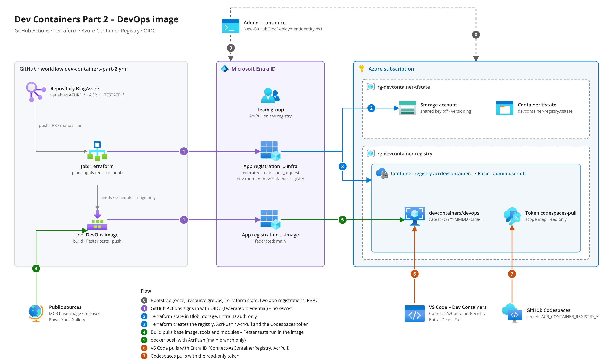
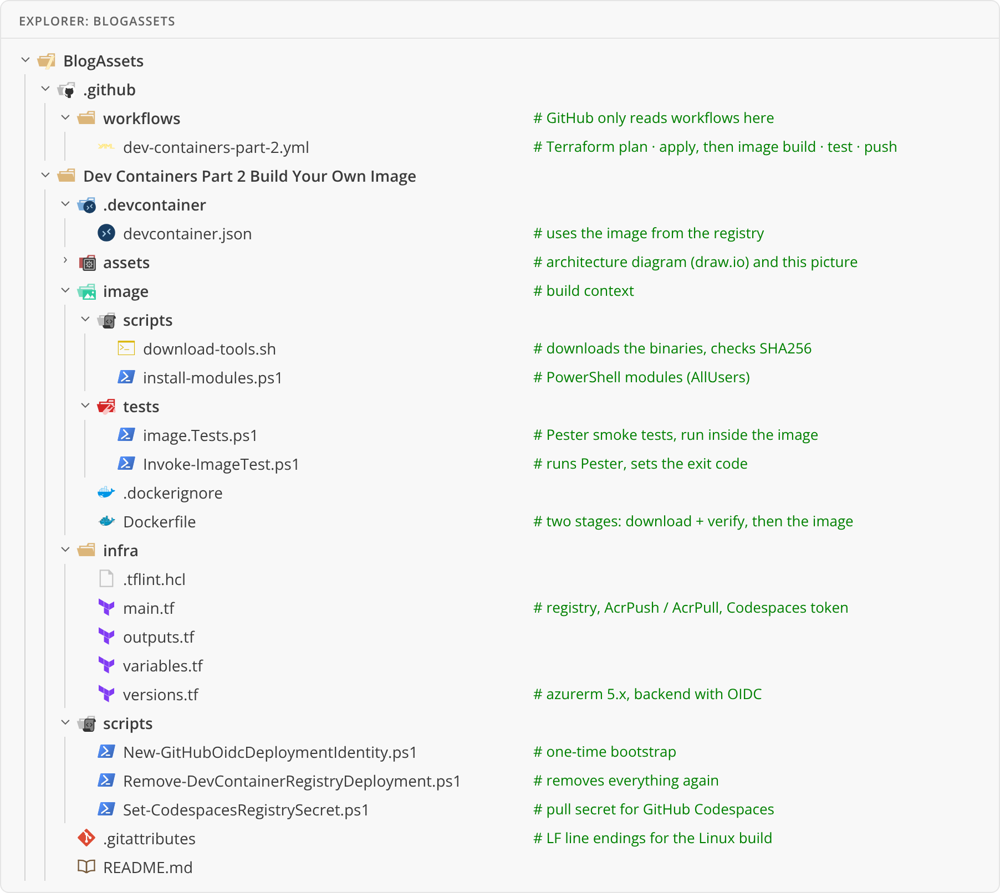

# Dev Containers for PowerShell, Part 2: Build Your Own DevOps Image

Assets for the blog post on [the-itguy.de](https://the-itguy.de). A custom dev container image for
DevOps work, built by GitHub Actions and pushed to Azure Container Registry. The registry is deployed
with Terraform in the same workflow. Both jobs sign in to Azure with federated credentials (OIDC) - no secrets.

## What's in the image

| Tool | Version |
|---|---|
| Base | `mcr.microsoft.com/devcontainers/base:3-noble` (Ubuntu 24.04) |
| PowerShell | 7.6.7 |
| Terraform | 1.16.6 |
| TFLint | 0.64.0 |
| Azure CLI | 2.91.0 |
| Ansible (community package) / ansible-lint | 14.5.0 / 26.10.1 |
| kubectl | 1.37.1 |
| Helm | 4.3.1 |
| GitHub CLI | 2.102.0 |
| PowerShell modules | Pester 5.7.1, PSScriptAnalyzer 1.24.0, PSFramework, powershell-yaml, Az.Accounts, Az.Resources, Az.ContainerRegistry, Microsoft.Graph.Authentication |

The versions live in one place: the `ARG ..._VERSION` lines of [`image/Dockerfile`](image/Dockerfile).

## Architecture



The editable diagram is [`assets/architecture.drawio`](assets/architecture.drawio) (draw.io, Azure stencils).

## Folder structure



The workflow lives in the repository root (GitHub only reads workflows there):
[`.github/workflows/dev-containers-part-2.yml`](../.github/workflows/dev-containers-part-2.yml).
It runs Terraform (plan, apply) and the image (build, Pester tests, push) - each only when its folder changed.

## Order

1. `Connect-AzAccount`, then run the bootstrap script:

   ```powershell
   $identity = @{
       GitHubOrganization = '<org>'
       GitHubRepository   = '<repo>'
       AcrPullGroupName   = 'grp-devcontainer-acrpull'
       AcrPullGroupMember = @(
           'alice@contoso.com'
           'bob@contoso.com'
       )
       ConfigureGitHub    = $true
       ResolveGitHubId    = $true
   }
   ./scripts/New-GitHubOidcDeploymentIdentity.ps1 @identity
   ```

   `AcrPullGroupName` creates an Entra ID security group for everyone who pulls the image. You are added
   automatically, plus everyone in `AcrPullGroupMember`. Terraform gives the group AcrPull on the registry.
   Leave both out if you pass existing object IDs with `-AcrPullPrincipalId` instead.
2. Run the workflow **Dev Containers Part 2** (Actions > Run workflow): it deploys the registry, then builds and pushes the image
3. Locally: `Connect-AzAccount`, `Connect-AzContainerRegistry -Name <registry>`, then **Dev Containers: Reopen in Container**
4. Codespaces: `./scripts/Set-CodespacesRegistrySecret.ps1 -RegistryName <registry> -GitHubRepository <org>/<repo>`

## Cleaning up

```powershell
$cleanup = @{
    GitHubOrganization = '<org>'
    GitHubRepository   = '<repo>'
    AcrPullGroupName   = 'grp-devcontainer-acrpull'
    WhatIf             = $true
}
./scripts/Remove-DevContainerRegistryDeployment.ps1 @cleanup
```

This shows what would be removed: role assignments, both resource groups, both app registrations, the AcrPull
group, the workflow runs, the Docker layer cache, the environment, the repository variables and the Codespaces
secrets. Run it without `WhatIf` to remove everything. The group is only deleted when you pass `AcrPullGroupName`
and the bootstrap script created it.
